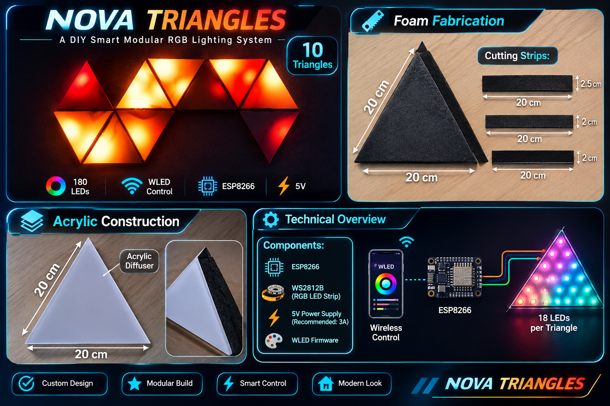
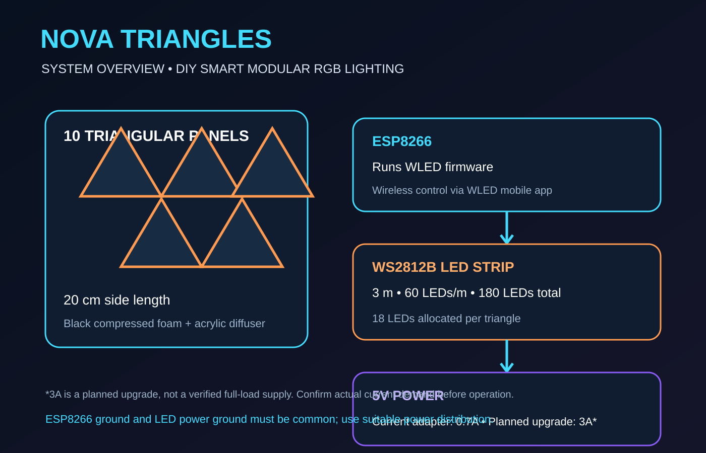

# NOVA TRIANGLES
### A DIY Smart Modular RGB Lighting System

NOVA TRIANGLES is a handmade, 10-panel triangular RGB lighting installation built using an ESP8266 running WLED and a WS2812B addressable LED strip.

The project combines DIY fabrication, basic enclosure design, addressable LEDs, and wireless lighting control.

## Project Preview

## Highlights

- 10 connected triangular lighting panels
- 180 WS2812B addressable RGB LEDs
- 3 metres of LED strip at 60 LEDs per metre
- 18 LEDs allocated to each triangle
- ESP8266 microcontroller running WLED
- Wireless control and built-in effects through the WLED mobile app
- Handmade black compressed-foam structure with acrylic diffusers

## System Overview

The diagram summarizes the system architecture. It is a conceptual overview, not a pin-by-pin wiring schematic.

## Hardware

| Part | Details |
|---|---|
| Microcontroller | ESP8266 |
| Firmware | WLED |
| LED type | WS2812B addressable RGB |
| LED strip density | 60 LEDs/m |
| Total strip length | 3 m |
| Total LED count | 180 |
| LEDs per triangle | 18 |
| LED supply voltage | 5 V |
| Main structure | Black compressed foam |
| Diffuser | Acrylic sheet |

## Physical Design

- Number of panels: 10
- Triangle side length: 20 cm
- Foam strip width: 2.5 cm
- The three frame-strip lengths were calculated as: 20 cm, (20 cm − foam thickness), and (20 cm − 2 × foam thickness), according to the build measurements.
- Acrylic pieces form the front light-diffusing surfaces.

## Build Documentation

### 1. Foam cutting and frame preparation

The black compressed foam was measured and cut to create the triangular frame and its supporting strips.

_Foam fabrication photo will be added to the project gallery._

### 2. Acrylic panel preparation

Acrylic sheet pieces were cut and arranged to form the triangular front panels.

_Acrylic preparation photo will be added to the project gallery._

### 3. LED installation and assembly

The WS2812B strip was installed in the handmade panels. The ten panels were connected to operate as one lighting installation.

### 4. Firmware and control

An ESP8266 runs WLED. The WLED mobile app is used to change colours, brightness, and select built-in lighting effects. The project uses WLED's available effects; custom effects are not claimed.

## Power Notes

The adapter currently used is rated **5 V / 0.7 A**. A **5 V / 3 A** supply is the planned upgrade, not a confirmed final installation.

The required supply capacity must be checked against the actual LED current at the intended brightness and effects. A 3 A supply should not be assumed sufficient for all 180 LEDs at full-white brightness. The planned 3 A adapter is an upgrade target, not a verified full-load supply. Use suitable power distribution, keep the ESP8266 and LED-strip grounds common, and avoid routing the full strip current through the ESP8266 board.

## Future Improvements

- Install and verify a suitably rated 5 V power supply.
- Improve and document power injection and wiring.
- Add a wiring diagram and close-up electronics photos.
- Explore custom WLED effects and smart-home integrations.

## Technologies

`ESP8266` · `WLED` · `WS2812B` · `Addressable RGB LEDs` · `Embedded Systems` · `DIY Fabrication`

## Project Details

- **Project:** NOVA TRIANGLES
- **Category:** DIY Electronics / Embedded Systems / Smart Lighting
- **Status:** Physical build completed; documentation and power-supply upgrade are ongoing.
- **Builder:** Mohamed Mansy

---

*Built from scratch, one triangle at a time.* 🔺
